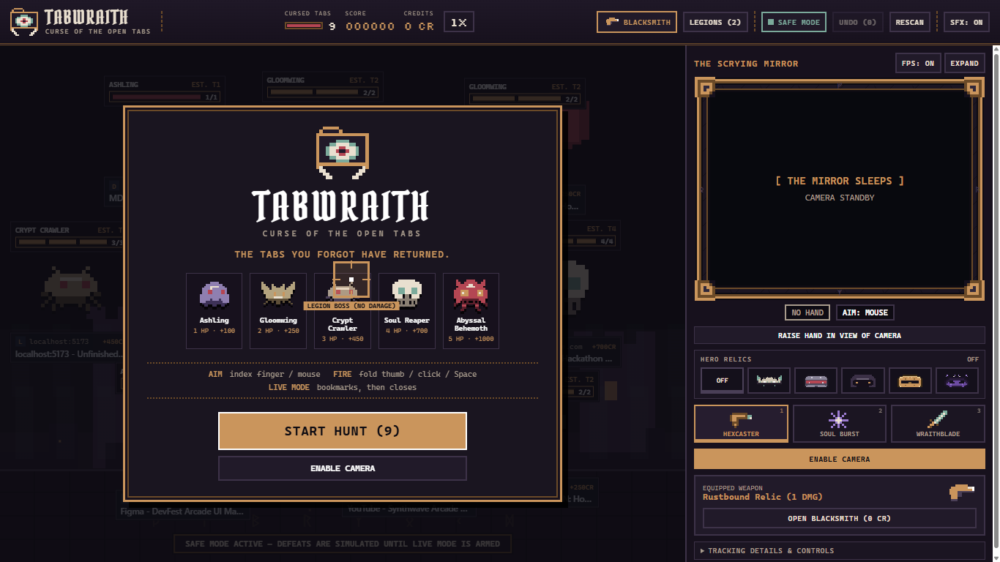
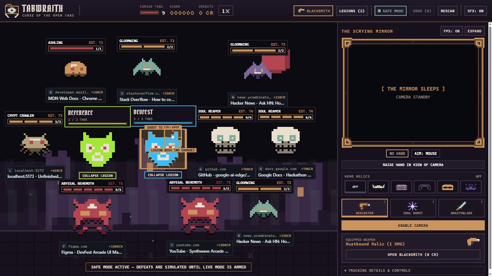

# TABWRAITH

Curse of the Open Tabs

TABWRAITH is a Chrome and Brave extension (Manifest V3) that turns your open browser tabs into pixel-art monsters. You hunt them with a mouse, the Space key, or hand gestures read from your webcam. In LIVE MODE a defeated monster's tab is bookmarked and then closed.



## What problem it solves

Tab overload is easy to ignore and tedious to clean up. TABWRAITH makes the cleanup a short game with guard rails: nothing is closed until you opt in, every closed tab is bookmarked first, and Undo reopens it.

## Key features

- Real tab discovery: every eligible open tab becomes a monster with its own HP.
- SAFE MODE by default. Defeats are simulated until you arm LIVE MODE.
- LIVE MODE closes a tab only on the final blow, after a bookmark is created. Undo reopens it.
- Cursed Legions: native Chrome and Brave tab groups appear as monster legions.
- Soul Archive: save a tab group and restore it later as a native group.
- Three combat styles driven by one MediaPipe hand tracker, with mouse and Space as fallbacks.
- The Blacksmith: three weapons with different damage, bought with credits earned in play.
- Hero Relics: five optional pixel face overlays on the webcam preview. Cosmetic only.
- Pixel sound effects synthesised with the Web Audio API. No audio files.

## Gameplay and combat styles

Each monster's HP and reward come from an estimated threat tier:

| Monster | Tier | HP | Credits |
| --- | --- | --- | --- |
| Ashling | 1 | 1 | 100 |
| Gloomwing | 2 | 2 | 250 |
| Crypt Crawler | 3 | 3 | 450 |
| Soul Reaper | 4 | 4 | 700 |
| Abyssal Behemoth | 5 | 5 | 1000 |

The tier is a heuristic based on the page URL and whether it plays audio. It is not a measurement of the tab's memory use.

| Style | Key | Gesture |
| --- | --- | --- |
| Hexcaster | 1 | Point your index finger to aim, raise your thumb to cock, fold it to fire |
| Soul Burst | 2 | Make a fist to arm the spell, then open your palm and hold briefly |
| Wraithblade | 3 | Raise index and middle fingers, fold ring and pinky, hold briefly to slash |

Only the selected style reads gestures. Each action hits the single monster under the crosshair. Mouse click and Space always work.

Weapons from the Blacksmith: Rustbound Relic (1 damage, free), Twin Hexcasters (2 damage, 600 credits), Abyssal Cannon (3 damage, 1500 credits).



The screenshots were captured in the extension's built-in simulated-target mode, which is used when it runs outside a browser extension.

## Installation

The extension is not in a browser store. Install the packaged build:

1. Download `tabwraith-v5.2.0-extension.zip` from the [latest release](https://github.com/sinagdevv/tabRaid/releases) and unzip it.
2. Open `brave://extensions` (or `chrome://extensions`) and turn on Developer mode.
3. Choose Load unpacked and select the unzipped folder that contains `manifest.json`.
4. Pin TABWRAITH and click its icon to open the arena in a tab.

To update, replace the folder contents and press Reload on the extension card.

## How to use

1. Open the arena and press START HUNT. Optionally enable the camera.
2. Aim and shoot with the mouse, Space, or your selected gesture.
3. Spend credits at the Blacksmith for stronger weapons.
4. To really close tabs, switch SAFE MODE to LIVE MODE in the top bar.
5. Use UNDO to reopen the last closed tab, and RESCAN to reload the tab list.

Pinned tabs, browser-internal pages, extension pages, and the arena tab are never targeted.

## Cursed Legions and Soul Archive

Each native tab group appears as a legion boss card with the group's title and color. Shooting the boss only expands or collapses the legion, never closes tabs. Individual tab monsters take damage on their own.

Open LEGIONS in the top bar to:

- expand or collapse a legion in the arena, or fold the native group in the tab strip
- save a group to the Soul Archive (URLs, titles, order, group name and color, saved in `chrome.storage.local`)
- review a group cleanup: a dialog lists the exact tabs, requires LIVE MODE, saves a Soul Archive snapshot, bookmarks every tab, then closes them. If any step fails nothing is closed.
- restore a saved group as a new native group. Restore reports tabs that could not be reopened. It does not recover unsaved page state, form data, or history.

## Browser permissions and privacy

| Permission | Used for |
| --- | --- |
| `tabs` | Listing, closing and reopening tabs |
| `tabGroups` | Reading and recreating native tab groups |
| `bookmarks` | Archiving a tab before it is closed |
| `storage` | Saving Soul Archive snapshots locally |
| Camera (browser prompt) | Optional hand tracking and Hero Relics |

Hand and face models are bundled with the extension (`public/mediapipe`) and run in the page through WebAssembly. Camera frames are processed locally and are not recorded, stored, or sent anywhere. The extension has no backend, account, or analytics. Camera access is requested only when you press Enable Camera.

## Technology stack

TypeScript, React 18, Vite, Chrome Extension Manifest V3, and MediaPipe Tasks Vision (Hand Landmarker and BlazeFace Face Detector). The promotional website in `site/` is a separate Vite and React app.

## Local development

```bash
npm install
npm run dev          # arena in simulated-target mode at the Vite URL
npm run typecheck
node scripts/gesture-test.ts   # synthetic-landmark gesture tests (Node 22.6+ or newer)
```

Open the dev URL with `?debug` to show a hitbox overlay and a test hook that accepts synthetic hand landmarks. It is intended for development only.

## Building the extension

```bash
npm run build        # outputs the loadable extension to dist/
```

Load `dist/` as an unpacked extension. The website builds separately:

```bash
cd site
npm install
npm run build
```

## Known limitations

- Gesture combat is experimental and depends on lighting, camera quality, and hand pose. The gesture logic is covered by synthetic-landmark tests, but I have not validated it with a physical webcam across many users.
- Hero Relics use a lightweight face detector. Overlay alignment on real faces is approximate and slows itself down, or switches off, if hand tracking suffers.
- Threat tiers are estimates, not measured RAM.
- The extension is an unpacked developer build, and LIVE MODE closes real tabs (after bookmarking them).
- Soul Archive restores URLs and group metadata only.

## Credits

Created for a DevFest project. All pixel art, sounds, and code in this repository were made for TABWRAITH. Hand and face tracking use Google's MediaPipe models.
